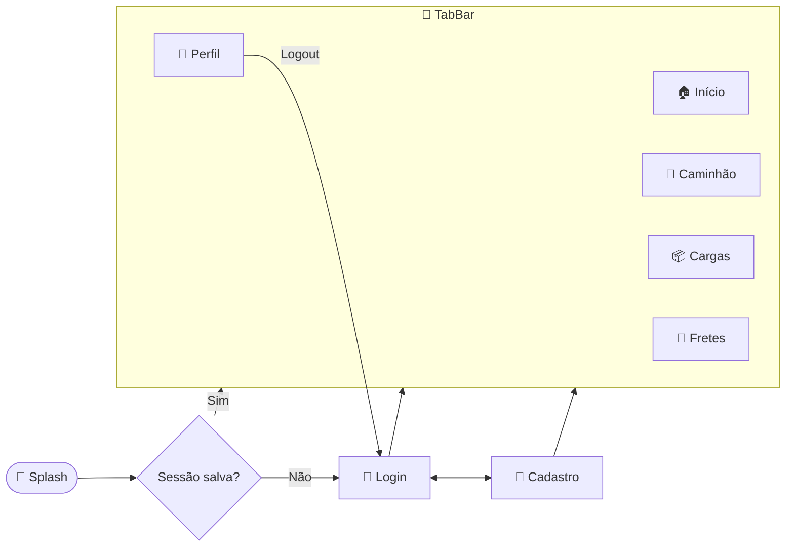
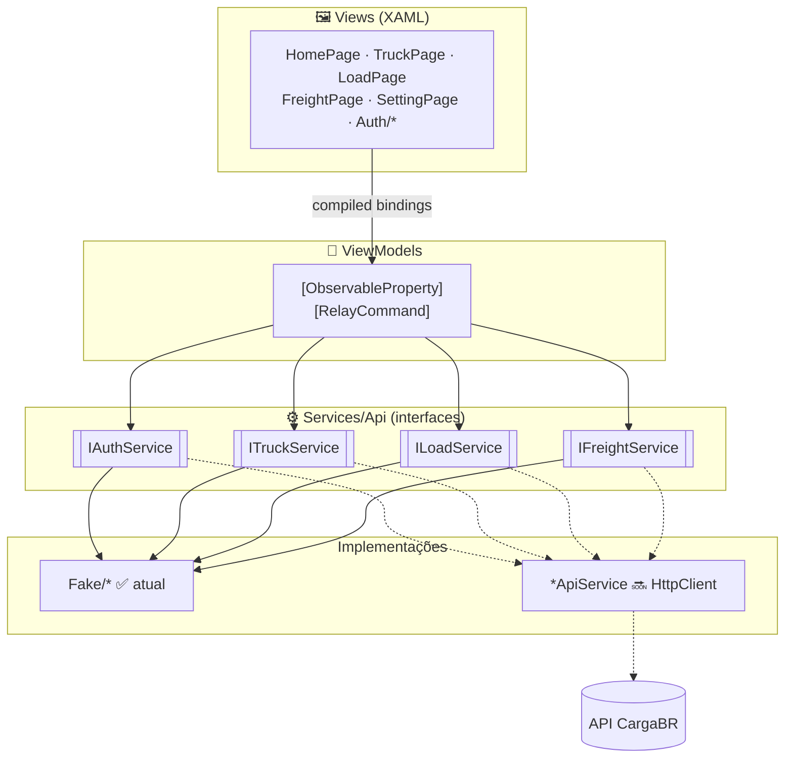
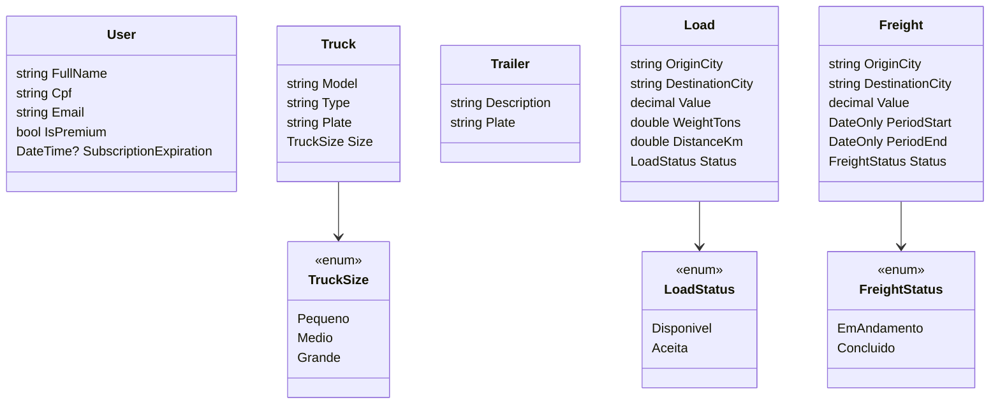

<div align="center">


# CARGAS BRASIL

**App de gestão de frota para caminhoneiros autônomos e pequenas transportadoras.**

Acompanhe caminhão, carretas, cargas disponíveis e fretes realizados, tudo em um só lugar.


[Telas](#-telas) •
[Funcionalidades](#-funcionalidades) •
[Arquitetura](#%EF%B8%8F-arquitetura) •
[Como rodar](#%EF%B8%8F-como-rodar) •
[Roadmap](#%EF%B8%8F-roadmap)

</div>

---

> [!NOTE]
> **Base técnica pronta.** Navegação, arquitetura, telas e camada de serviços estão funcionais com **dados simulados** (com delay de rede). A integração com a API real é o próximo passo. Veja o [Roadmap](#%EF%B8%8F-roadmap).

---

## 📱 Telas

| Login | Início | Caminhão | Cargas | Fretes | Perfil |
|:---:|:---:|:---:|:---:|:---:|:---:|
|  |  |  |  |  |  |

<details>
<summary><b>🌙 Tema escuro</b></summary>

| Início | Caminhão | Cargas | Perfil |
|:---:|:---:|:---:|:---:|
|  |  |  |  |

</details>

<details>
<summary><b>🖥️ Versão desktop (Windows)</b></summary>


</details>

---

## ✨ Funcionalidades

| | Tela | O que faz |
|:---:|---|---|
| 🔐 | **Login / Cadastro** | Validação de formulário, loading, mensagens de erro e sessão persistida |
| 🏠 | **Início** | Resumo de ganhos do mês, entregas e atalhos rápidos |
| 🚚 | **Meu Caminhão** | Dados do veículo, lista de carretas e cadastro de nova carreta |
| 📦 | **Cargas Disponíveis** | Lista de cargas com origem, destino, peso, distância e aceite |
| 🧾 | **Meus Fretes** | Histórico de fretes com status (em andamento / concluído) |
| 👤 | **Perfil** | Dados do usuário, assinatura, troca de tema e logout |
| 🌗 | **Tema** | Claro, Escuro ou Sistema, salvo entre sessões |

---

## 🧭 Navegação



---

## 🏗️ Arquitetura

MVVM com injeção de dependência. As telas dependem **apenas de interfaces**, então trocar os dados fake pela API real não exige mexer em nenhuma View ou ViewModel.



<details>
<summary><b>🗂️ Modelo de domínio</b></summary>



</details>

<details>
<summary><b>📁 Estrutura de pastas</b></summary>

```
CargaBR/
├── App.xaml(.cs)          # Bootstrap, aplica o tema salvo
├── AppShell.xaml(.cs)     # Rotas + TabBar
├── MauiProgram.cs         # DI, fontes, CommunityToolkit
├── Models/                # Truck, Trailer, Load, Freight, User
│   └── Enums/             # TruckSize, LoadStatus, FreightStatus
├── Services/
│   ├── Api/               # Interfaces de domínio
│   │   └── Fake/          # Implementações simuladas
│   ├── Theme/             # Troca e persistência de tema
│   └── SubscriptionService.cs
├── ViewModels/            # Um por tela (+ Auth/)
├── Views/                 # Páginas XAML (+ Auth/)
├── Converters/            # Conversores de binding
└── Resources/
    ├── Styles/            # Colors.xaml, Styles.xaml
    ├── AppIcon/, Splash/  # Identidade visual
    └── Fonts/             # Open Sans + Font Awesome
```

</details>

---

## 🎨 Identidade visual

| Cor | Hex | Uso |
|:---:|---|---|
|  | `#2962FF` | Primária |
|  | `#1C2331` | Secundária, ícone e splash |
|  | `#2E7D32` | Sucesso |
|  | `#FF5252` | Alerta |

Fontes: **Open Sans** (texto) e **Font Awesome 7** (ícones da TabBar e da interface).

---

## ▶️ Como rodar

**Pré-requisitos:** .NET 10 SDK + workloads MAUI, ou Visual Studio 2022 17.14+ com a carga de trabalho .NET MAUI.

| Plataforma | Comando |
|---|---|
| 🪟 Windows | `dotnet build CargaBR.csproj -f net10.0-windows10.0.19041.0 -t:Run` |
| 🤖 Android | `dotnet build CargaBR.csproj -f net10.0-android -t:Run` |
| 🧰 Todas | `dotnet build CargaBR.csproj` |

Ou abra `CargaBR.slnx` no Visual Studio e rode direto pela IDE.

> 💡 O login é simulado: qualquer e-mail e senha que passem na validação do formulário entram no app.

---

## 🛣️ Roadmap

- [x] Arquitetura MVVM + DI
- [x] Navegação Shell com TabBar
- [x] Autenticação simulada com sessão persistida
- [x] Tema claro/escuro/sistema
- [x] Telas de Início, Caminhão, Cargas, Fretes e Perfil
- [ ] Implementações reais dos serviços com `HttpClient`
- [ ] Autenticação JWT
- [ ] Assinatura premium ligada à API
- [ ] Publicação nas lojas

<details>
<summary><b>🔌 Como plugar a API real</b></summary>

1. Crie as implementações reais, por exemplo `TruckApiService : ITruckService`.
2. Defina a URL base em `Services/Api/ApiSettings.cs`.
3. No `MauiProgram.cs`, troque o registro fake:

```csharp
builder.Services.AddHttpClient<ITruckService, TruckApiService>(c => c.BaseAddress = new Uri(ApiSettings.BaseUrl));
```

4. Repita para `IAuthService`, `ILoadService` e `IFreightService`.
5. Busque por `// TODO` no código: cada método fake indica a chamada HTTP que deve substituí-lo.

</details>

---

<div align="center">

Feito por **[Guilherme Amorim](https://github.com/gu1Amorim)** · [LinkedIn](https://linkedin.com/in/gu1amorim)

</div>
